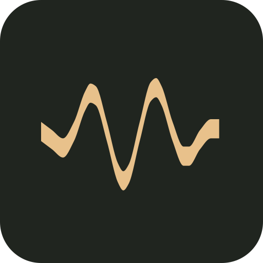
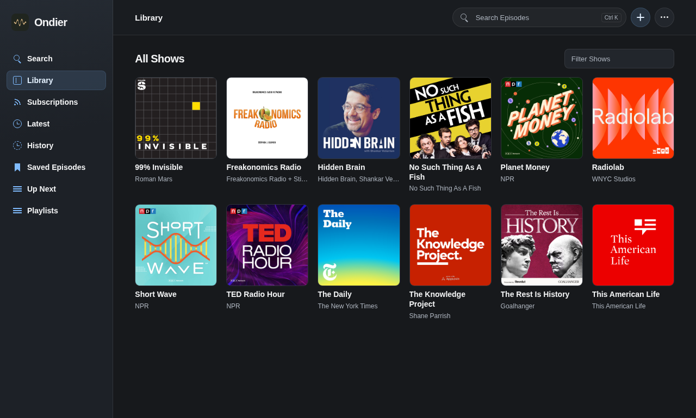
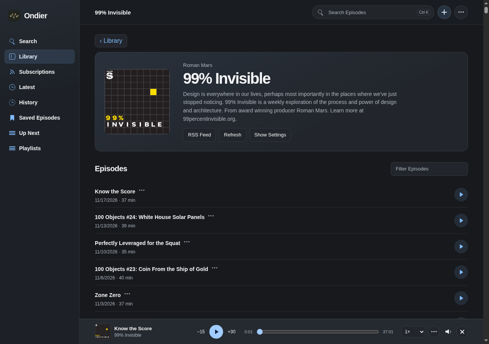
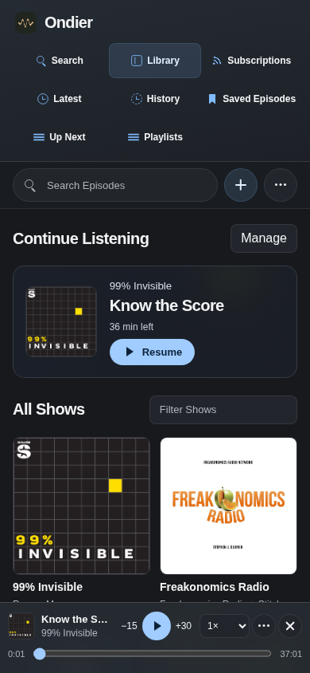

<p align="center">
  
</p>

<h1 align="center">Ondier</h1>

<p align="center"><strong>Keep the podcasts and Youtube channels you follow on your own server.</strong></p>

<p align="center">
  Follow RSS feeds and YouTube channels, listen in your browser, and pick up where you left off in a gPodder-compatible player. Ondier runs in a single Docker container.
</p>

<p align="center">
  <a href="#docker-setup"></a>
  &nbsp;
  <a href="LICENSE"></a>
</p>

<p align="center">
  <a href="#what-you-can-do">Features</a> · <a href="#docker-setup">Get started</a> · <a href="#connect-your-player">Connect your player</a> · <a href="docs/SELF-HOSTING.md">Self-hosting guide</a>
</p>

<p align="center">
  <a href="docs/screenshots/library.png"></a>
</p>

## What you can do

- **Build one podcast library.** Follow public RSS feeds and YouTube channels, find shows through Apple Podcasts, or import your subscriptions from OPML. Export them again when you want to use another player.
- **Keep your place across devices.** Sync listening positions, saved episodes and your up-next queue between the browser and clients that support Ondier’s API. gPodder-compatible clients can sync subscriptions and playback progress.
- **Find an episode you heard before.** Search titles, descriptions and publisher-provided transcripts. Ondier retains indexed episode metadata when a publisher removes an episode from its feed.
- **Make room for longer listening.** Create manual collections or smart playlists filtered by show, category, keywords, duration and listening status. Set a minimum episode duration for a subscription.
- **Bring audio and video together.** Follow YouTube channels and configure matching against official YouTube or France.tv releases, including provider order and per-episode overrides.
- **Keep other players in the loop.** Share a private RSS feed for a show or playlist, or connect through gPodder sync.

## From your desk to your phone

<p align="center">
  <a href="docs/screenshots/episode.png"></a>
  &nbsp;
  <a href="docs/screenshots/mobile.png"></a>
</p>

The web player includes playback speed, skip controls, saved episodes and an up-next queue. Use the same server address in a compatible client to continue listening there.

## Docker setup

You need Docker with the Compose plugin. On macOS or Windows, start your Docker application first. On Linux, start the Docker service.

```sh
git clone https://github.com/arkemys-consulting/Ondier.git
cd Ondier
bash install.sh
```

1. Open [Ondier on localhost](http://localhost:8788).
2. Read the first-account setup key with `cat data/setup-key`. Enter it in **Create your Ondier account**, then choose your username and password.
3. Open **Search** to add a podcast, or **Subscriptions → Import OPML** to bring your existing feeds.

The installer generates unique installation and setup keys. Each new installation starts with an empty library. Keep `.env` and `data/` when upgrading.

The [self-hosting guide](docs/SELF-HOSTING.md) covers another port, HTTPS and remote access, YouTube configuration, backups, and updates.

## Connect your player

**Roan.** In Ondier, open **Settings → API Keys** and create a named key. Enter your Ondier address and that key in Roan’s Ondier settings. Roan can use the shared library, playback positions, saved episodes, queue and video preferences.

**gPodder-compatible apps.** Open **Settings → Sync Setup** for the server address and app password. Ondier supports the gPodder API and a Nextcloud gPodder Sync login flow.

**Other RSS players.** Use **RSS Feed** on a show or **Private RSS Feed** on a playlist. RSS carries the feed and episodes; playback-state sync requires a compatible client.

## Backups and updates

Download a signed backup from **Settings → Download Backup**. Ondier also keeps the seven most recent daily backups in `data/backups/`. Keep a separate copy of `.env`, whose installation key preserves private feed links and verifies backups.

To update a Git checkout:

```sh
git pull
bash install.sh
```

Your account, library and playback state stay in `data/`. The [backup and restore instructions](docs/SELF-HOSTING.md#backups-and-restore) cover moving to another host.

## Development

The server uses Python 3.12, SQLite and a plain JavaScript web interface. The Docker image also includes yt-dlp and Deno for supported YouTube playback. There is no separate database container.

```sh
docker build -t ondier-server:local .
bash tests/run.sh
```

See [the architecture notes](docs/ARCHITECTURE.md) for the API and source layout.

## License and credits

Copyright (C) 2026 Ondier contributors. Ondier’s original code is licensed under the [GNU General Public License v3.0](LICENSE), **GPL-3.0-only**.

Ondier uses [hls.js](https://github.com/video-dev/hls.js), [yt-dlp](https://github.com/yt-dlp/yt-dlp), [Deno](https://deno.com/) and Python. Their licenses and notices remain applicable; see [third-party notices](docs/THIRD-PARTY.md). Podcast titles, artwork and episode content shown in screenshots belong to their respective publishers.
